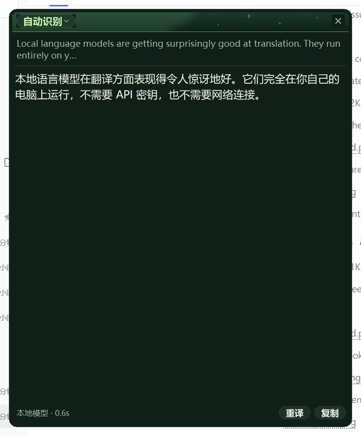
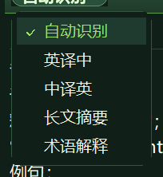
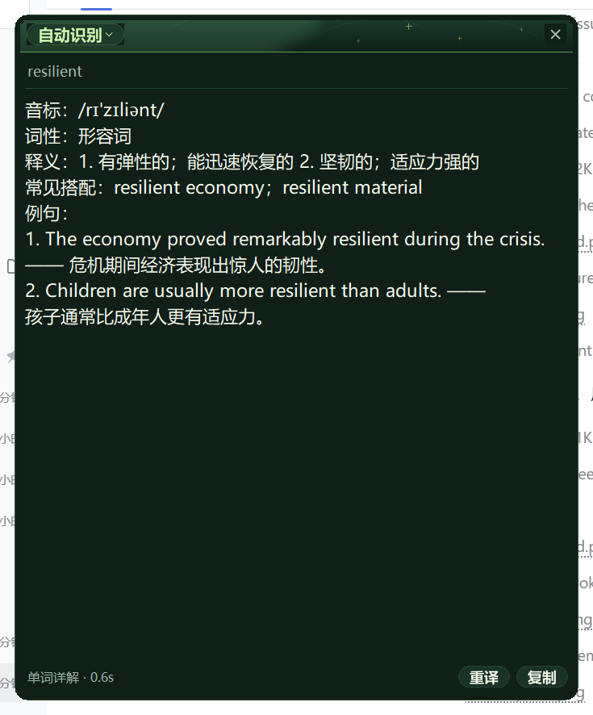
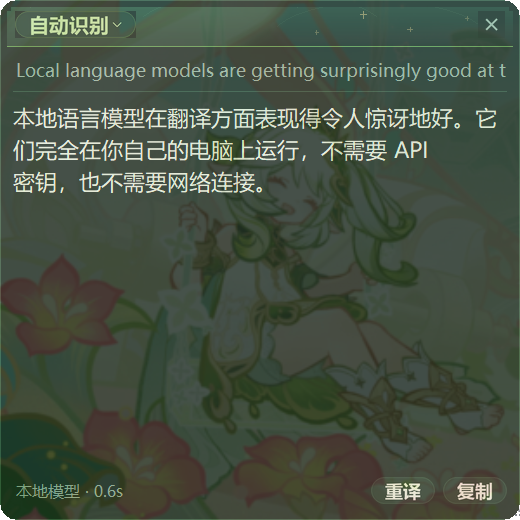
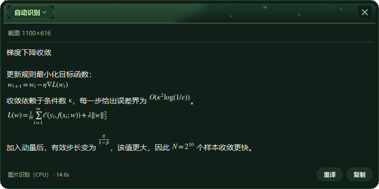

# nahida-translator

> Windows 划词翻译 + 截图翻译 · 本地 Qwen2.5-7B / Qwen3-VL-4B · 纳西妲主题 · 完全离线，无需任何 API Key

选中英文 → 松开鼠标 → 旁边浮出「译」小按钮 → 点一下 → 右侧弹出中文译文卡片。

按 `Ctrl+Alt+D` 框选屏幕任意区域，可以直接翻译论文公式、扫描版 PPT、没有文字层的截图——
公式会还原成 LaTeX 并排版成真正的分式、根号、上下标显示。

体验类似豆包/浏览器自带的划词翻译，但**推理全部跑在你自己电脑上**：模型是本地量化的
Qwen2.5-7B-Instruct（文字）和 Qwen3-VL-4B（图片），引擎是 llama.cpp，不联网、不付费、不需要登录，
也没有任何云端调用。

界面是纳西妲（草神）风格的暗绿主题：深林绿底、草绿高亮、奶白文字，标题带有叶脉纹理和金色微光，
全部由程序用 PIL 现场绘制，不含任何游戏素材。

> 为什么做这个项目 → [MOTIVATION.md](MOTIVATION.md)



---

## 功能特性

- **划词即译**：拖选 / 双击选词都会浮出「译」按钮，`Ctrl+Alt+T` 可直接处理
- **截图翻译**：`Ctrl+Alt+D` 全屏框选，翻论文公式、扫描版 PPT、图片型 PDF；`Win+Shift+S` 截完再按
  `Ctrl+Alt+T` 也能翻剪贴板里的图
- **公式保真**：图片里的公式识别成 LaTeX，面板里渲染成真正的分式、根号、求和上下限、矩阵，而不是
  `\frac{1}{2}` 这样一串源码；复制时给出的是 LaTeX 原文，粘到 Word / Markdown 里可以直接用
- **五种模式**：自动识别、英译中、中译英、长文摘要、术语解释；面板左上角一键切换，并记住上次选择
- **单词详解**：选中单个英文单词时，自动给出音标、词性、释义、搭配和双语例句，而不是简单直译
- **流式输出**：译文边生成边显示，单句约 0.1~0.8 秒（RTX 5060 实测）
- **常驻面板 + 任务栏按钮**：右下角常驻「译」按钮随时把面板叫到最前；面板可拖动、四边/四角缩放
- **半透明动态背景**：本地 GIF 作为面板底层背景（按面板比例裁剪），面板闲置 30 秒自动鼠标穿透，不挡划词（鼠标移到按钮上会立刻恢复可点）
- **无 API、无网络**：模型与引擎首次下载后，之后只访问 `127.0.0.1`

## 截图

| 模式选择 | 单词详解 |
|---|---|
|  |  |

| 常驻按钮 | 译文面板 |
|---|---|
|  |  |

截图翻译：扫描版 PPT 的识别结果，公式渲染成真正的分式、根号、求和上下限
（下图是视觉模型真实输出的截图，未经改写）：



## 环境要求

- Windows 10 / 11
- Python 3.10+（`python --version` 可用）
- 可选：NVIDIA 显卡（显存 ≥ 6GB 体验最佳；没有显卡会自动回退 CPU 推理，速度慢 3~5 倍）
- 磁盘约 10GB（文字模型 4.4GB + 视觉模型 3.2GB + 引擎 0.7GB）
- 内存 ≥ 8GB（图片翻译时视觉引擎常驻约 3.2GB 内存，闲置 10 分钟自动退出）

## 快速开始

```bash
git clone https://github.com/cwh-123456/nahida-translator.git
cd nahida-translator
```

1. 双击 `launchers\setup.bat`（只需一次）
   - 安装 Python 依赖；
   - 下载 llama.cpp 引擎（约 550MB）；
   - 下载 Qwen2.5-7B-Instruct Q4_K_M 文字模型（约 4.4GB）；
   - 下载 Qwen3-VL-4B 视觉模型 + 视觉投影层（约 3.2GB，图片翻译用）；
   - 中断了不要紧，重新运行会断点续传。
2. 双击 `start.bat` 启动（无控制台，托盘和右下角出现「译」）。
3. （可选）想要动态看板娘：把任意 GIF 命名为 `nahida_swing.gif` 放进 `assets\`。

> 只想用划词翻译、不想要图片功能？`python tools\download.py --no-vision` 可以省掉那 3.2GB，
> 代价是按 `Ctrl+Alt+D` 时会提示缺少视觉模型。

> 仓库不包含模型、引擎和图片素材（体积与版权原因），首次运行必须执行第 1 步。

## 使用说明

| 操作 | 说明 |
|---|---|
| 拖选 / 双击选词 | 松开后浮出「译」，点它开始翻译 |
| `Ctrl+Alt+T` | 选中后直接翻译，不用点图标；剪贴板里是图片时改为翻那张图 |
| `Ctrl+Alt+D` | 全屏框选截图并翻译（论文公式、扫描件、图片型 PDF） |
| 框选时 | 拖出区域松手即开始；`Esc` 或右键取消；左上角实时显示区域像素尺寸 |
| 切换模式 | 点面板左上角模式按钮（如「自动识别 ▾」）；或右键右下角「译」→ 模式 |
| 关闭面板 | 面板右上角 `✕`；之后点托盘图标或右下角「译」可重新打开 |
| 移动 / 缩放面板 | 拖标题栏移动，拖任意一条边或四个角缩放，位置和尺寸自动记住 |
| 面板置顶 | 默认置顶，点其他软件不会把面板盖住 |
| 复制 / 重译 | 面板底部按钮，或选中译文用 `Ctrl+C`；带公式时复制到的是 LaTeX 原文 |
| 改原文 / 手动输入 | 面板顶部的原文框可以直接编辑：划词结果不对就随手改，改完点「重译」或按 `Ctrl+回车`；点右下角「译」打开空面板时也能直接输入一段文字来翻 |
| 退出程序 | 右键右下角常驻「译」→ 退出程序（最可靠）；托盘右键 → 退出 |
| 强制结束 | 双击 `launchers\quit.bat`；`launchers\restart.bat` 可一键重启 |

> `Ctrl+Alt+D` 是用 Windows 的 `RegisterHotKey` **独占注册**的，按下时不会连带触发别的截图软件。
> 如果这个键已经被别的程序占了，启动时会自动顺延到 `Ctrl+Alt+K` / `Ctrl+Alt+Q`，
> 并把实际生效的键写进托盘提示和面板状态栏（日志 `logs\app.log` 里也有）。

## 五种模式

| 模式 | 作用 | 示例 |
|---|---|---|
| 自动识别（默认） | 单个英文单词 → 单词详解；含中文 → 中译英；其余 → 英译中 | 选中 `resilient` 自动查词 |
| 英译中 | 强制英译中 | 整段英文 → 中文 |
| 中译英 | 强制中译英（会自动校正混入的中文） | 中文句子 → 英文 |
| 长文摘要 | 中文要点 + 一句话总结，长文自动分段再合并 | 文章 / 邮件 → 3~6 条要点 |
| 术语解释 | 中文译名、领域、释义、用法、中英示例 | `zero-shot learning`、`ROI` |

截图翻译沿用同一套模式选择：**自动识别 / 英译中 / 中译英都按「翻成中文」处理**（图片里是哪国文字
由视觉模型自己判断），**长文摘要**和**术语解释**则使用各自的图片版提示词。

## 配置

首次运行会生成 `config\config.json`（已在 `.gitignore` 中忽略）。改完重启程序生效，常用项：

| 配置 | 含义 |
|---|---|
| `mode` | 当前模式：`auto` / `translate` / `zh2en` / `summary` / `term` |
| `hotkey` | 划词翻译快捷键，默认 `<ctrl>+<alt>+t`，留空关闭 |
| `hotkey_shot` | 截图翻译快捷键，默认 `ctrl+alt+d` |
| `hotkey_shot_fallbacks` | 上面的键被占用时依次尝试的备用键，默认 `["ctrl+alt+k", "ctrl+alt+q"]` |
| `server.gpu_layers` | 交给显卡的层数，99 = 全部；显存不足改 30 或 0（纯 CPU） |
| `server.port` | 文字引擎端口，默认 8377 |
| `server.model` | 文字模型路径，可换成更小/更大的 GGUF |
| `vision.model` / `vision.mmproj` | 图片翻译的主模型与视觉投影层，两个必须版本对应 |
| `vision.port` | 图片引擎端口，默认 8378；被占用时自动往后找 |
| `vision.gpu_layers` | 视觉模型交给显卡的层数，默认 0（纯 CPU，见下方说明） |
| `vision.idle_timeout` | 视觉引擎闲置多少秒后自动退出释放内存，默认 600 |
| `vision.max_image_side` | 送进模型前把图片长边缩到这个尺寸内（越大越准、越慢），默认 1600 |
| `ui.panel_alpha` | 面板不透明度（默认 0.72） |
| `ui.panel_bg` | 是否启用动态背景 |
| `ui.panel_auto_passthrough` | 面板闲置 30 秒后自动鼠标穿透（默认开；鼠标悬停到按钮上会自动恢复可点） |
| `ui.mascot_enabled` / `ui.mascot_size` / `ui.mascot_gif` | 看板娘开关、尺寸、动图路径 |
| `ui.window_pos` / `ui.popup_width` / `ui.popup_height` | 面板位置与尺寸（自动记录） |
| `translate.temperature` | 越低越稳定，翻译建议 0.2~0.4 |

**为什么图片引擎默认跑 CPU，而不是显卡？** 8GB 显存装不下 7B 文字模型 + VL 视觉模型两套权重，
同时驻留会溢出到内存反而更慢。视觉模型纯 CPU 识别一张扫描件约 13~15 秒，对「拍张 PPT 让它翻」
够用，而且不占显存、不干扰你日常划词。显存 ≥ 12GB 的话可以把 `vision.gpu_layers` 改成 99。

两个引擎是**独立进程、按需启动**：文字引擎开机预热，图片引擎第一次截图时才起来（加载约 2 秒），
闲置 10 分钟自动退出。

换成更小的模型（如 Qwen2.5-3B）：把 GGUF 放进 `models\`，改 `server.model` 指向它即可。

配置文件采用「原子写 + 只写回改动字段」的方式保存：切模式、拖面板这类操作只会更新对应的几项，
不会把程序内存里的临时状态一并写进文件；写入时先写同目录临时文件再整体替换，
中途崩溃也不会留下半个 JSON，多个界面回调同时保存也不会互相踩。若文件损坏到无法解析，
程序会先把它备份成 `config\config.json.bad-<时间戳>` 再按默认值启动，并在日志里记一条错误。

## 目录结构

```
nahida-translator/
├─ start.bat                入口：启动（无控制台）
├─ launchers/
│  ├─ start_debug.bat       调试启动（保留控制台看日志）
│  ├─ setup.bat             首次安装（依赖 + 引擎 + 模型下载，可断点续传）
│  ├─ quit.bat              强制结束正在运行的实例
│  └─ restart.bat           强制结束旧实例并重新启动
├─ config/
│  ├─ config.json           配置（首次运行生成，git 忽略）
│  └─ requirements.txt      Python 依赖
├─ app/
│  ├─ main.py               入口：托盘、常驻按钮、单实例、事件编排
│  ├─ engine.py             文字推理：拉起 llama-server、流式翻译
│  ├─ vision.py             图片推理：独立的视觉引擎 + 图片翻译提示词
│  ├─ shot.py               框选截图（冻结屏幕）、剪贴板图片读取
│  ├─ hotkey.py             RegisterHotKey 全局热键（带占用检测与顺延）
│  ├─ mathrender.py         LaTeX → 图片，译文里公式混排
│  ├─ selection.py          划词捕获：鼠标钩子 + Ctrl+C + 剪贴板还原
│  ├─ ui.py                 悬浮图标 / 常驻按钮 / 看板娘 / 译文面板（tkinter）
│  └─ config.py             配置读写
├─ assets/                  看板娘动图（自行放入，git 忽略）
├─ docs/                    截图
├─ tools/
│  ├─ download.py           引擎/模型下载（断点续传，--no-vision 跳过图片模型）
│  ├─ bench.py              引擎基准测试
│  └─ kill_app.ps1          强制结束实例（quit/restart 调用）
├─ logs/                    运行日志（git 忽略）
├─ models/                  GGUF 模型（git 忽略）；图片模型在 models\vision\
└─ runtime/                 llama.cpp 引擎与 CUDA 运行库（git 忽略）
```

## 技术实现

- **界面**：tkinter 无边框窗口 + PIL 抗锯齿绘制（圆角、按钮、标题带、动图逐帧）
- **取词**：`pynput` 全局鼠标/键盘钩子，模拟 `Ctrl+C` 后读剪贴板再还原（带哨兵值检测，剪贴板已有相同内容也能识别）
- **文字推理**：`llama-server`（llama.cpp）子进程，SSE 流式输出；显存不足自动回退 CPU
- **图片推理**：另起一个 `llama-server` 加载 `--mmproj` 视觉投影层，纯 CPU、按需启动、闲置自动退出
- **截图**：先把整个虚拟桌面抓成一张图冻结显示，框选期间鼠标全程在自己的窗口上，
  松手直接从这张图裁剪——不会丢事件，也不可能把遮罩本身截进去。
  框选界面用黑底蓝框，四周压暗、选区保持原色（和 QQ 截图一样）；
  结果面板和划词翻译统一用纳西妲绿，两条路径一个配色
- **公式排版**：matplotlib mathtext（STIX 字体）渲染成透明底图片插进 Text 控件；3 倍分辨率渲染再降采样，
  按 `depth` 修正基线。mathtext 不认矩阵环境，所以在它之上加了一层结构化排版：拆出行列网格、
  每格单独渲染、按列宽与基线拼回、自己画括号，`bmatrix` / `pmatrix` / `cases` / `aligned` 都能出图；
  实在排不出来的（公式里混中文、未知命令）降级成源码并标色，复制出来仍是可用的 LaTeX
- **热键**：Win32 `RegisterHotKey` 独占注册，被占用时自动顺延（钩子是广播，会双触发）
- **窗口细节**：Win32 `SetWindowRgn` 圆角、`WS_EX_TRANSPARENT` 鼠标穿透、`SetWindowLong` 动态开关
- **单实例**：命名互斥量 + PID 文件 + 退出看门狗，避免旧进程残留

## 常见问题

**某些程序里划词没反应？**
以管理员权限运行的程序会拦截普通程序的模拟按键（Windows UIPI 限制），换普通窗口即可；
终端里 `Ctrl+C` 是中断信号，建议避开。

**第一次翻译很慢？**
4.4GB 模型正在读入显存（约 3 秒）；若长时间不动，看 `logs\llama-server.log`。
显存不足会回退 CPU，速度慢但可用。

**会不会偷偷联网？**
不会。下载只在 `launchers\setup.bat` 执行一次；程序只访问 `127.0.0.1:8377`，
`llama-server` 也只绑定本机，外网无法访问。

**想确认引擎状态？**
`python app\main.py --test "Hello world"` 可在命令行直接翻译并打印耗时。

**设置莫名其妙变回默认了？**
先看 `config\` 下有没有 `config.json.bad-<时间戳>`。有，说明原文件无法解析，
程序把原内容备份后按默认值启动了，把备份里想保留的几项抄回去即可；
没有，说明是某个开关被正常改过，直接在下拉菜单 / `config.json` 里改回来。

**点叉之后还剩一块动图 / 背景？**
背景动图是独立于面板的窗口。两种情况都会表现成「面板没了、只剩动图」，但原因不同：

1. **面板真的隐藏了，背景层没跟着收起**：面板一旦 Unmap 就会连带收起背景层，主循环每 250ms
   还会巡检一次，日志里对应 `面板不可见但背景层仍在显示`、`关闭后背景层仍然可见`。
2. **面板还在，但背景层翻到了它上面**：背景层是实心不透明的，压上去就把面板整块盖住，
   Tk 那边 `winfo_ismapped()` 仍然是 True，所以只看状态位发现不了。触发条件是面板处于
   穿透状态时的一次点击（点击穿到下面的程序，系统重排 z-order 时顺手翻了我们这两层）。
   现在主循环每 250ms 做一次只读的 z-order 检查（`背景层翻到了面板上面`），发现就压回去；
   穿透状态下载面板上单击也会立刻唤醒面板并把层级摆正。

如果还能复现，把 `logs\app.log` 里这几种 `WARNING` 发出来即可定位。

**拖动面板时，背景动图留在原地 / 面板自己跳到别处？**
背景动图是独立窗口，正常路径（打开、改尺寸、拖动）都会同时写两边的几何。出错有三种成因：

1. **两个窗口没在同一批里移动**（拖起来「动图落后半拍、手一停就追上来」）：Tk 的
   `geometry()` 只记账，真正的 `SetWindowPos` 排在 idle 队列里；快速拖动把队列刷满，
   两个窗口的移动之间就夹进系统合成的一帧。现在拖动/改尺寸直接用 `DeferWindowPos`
   把面板和背景**同一批**挪到位（`move_together()`），不等 idle。拖动过程中也暂停
   自动重排（会改高度、重画帧图），松手时补一次——代价是拖动那几秒里面板不跟着译文
   长高，松手立刻补齐。
2. **某一次位置没落到背景窗口上**：Tk 自己的记录却认为已经对齐了，之后所有同步都被
   「几何没变」挡掉，错位就一直留着（表现为「面板走了，动图留在原地」）。主循环每 250ms
   用系统矩形（`GetWindowRect`）核对一次，不一致就用 `force_geometry()` 把背景挪回去
   ——先错开一个像素再挪回来，绕开 Tk 的「没变化就跳过」。日志里对应 `背景层与面板错位`。
3. **按下的那一下被穿透吃掉**：面板闲置后是鼠标穿透的，按下落到下面的程序上，等悬停唤醒
   让面板重新可交互时，手里这串移动事件才落到标题带上。这时没有「按下」记录，
   用旧偏移算过去会把面板甩到离光标很远的地方。现在没有按下的移动一律忽略。

**图片识别到一半点叉，它还在后台跑？**
现在不会了。点叉（或按 `Esc`）不只是把面板藏起来，还会把取消信号发到工作线程：
流式读取每收到一段就查一次，发现已取消立刻断开连接，引擎那边也随之停下。
同时 `busy` 立刻复位，所以关了面板马上就能再按 `Ctrl+Alt+D` 截下一张，不会提示
「正在处理上一次请求」。日志里对应两行：`面板被关闭，取消进行中的任务`、`图片翻译已取消`。

取消有一个做不到的地方要说清楚：模型刚开始工作、还没吐第一个字的十几秒里（读图 + 预处理），
客户端这边收不到任何数据，取消要等第一个 token 到来才生效。但界面上已经是「关掉、可以继续」
的状态——旧任务的结果不会再写进任何面板（事件带着任务代际，过期的直接丢弃）。

**穿透状态下面板要点两下才响应？**
以前是这样，现在已经修掉了，靠两件事：
1. **鼠标悬停就提前解除穿透**。鼠标移到标题带 / 按钮 / 边角上时，钩子立刻把面板
   变回可点击——所以"移过去点一下"就生效，不用先空点一次。
2. **可交互窗口从"结果出现"算起，不再从"任务开始"算起**。以前只在面板弹出时
   给 6 秒可点，而图片翻译要 12 秒以上，结果一到其实早就过期了，点叉必然两下。
   现在每收到一个 token 都续期，`finish()` 再续 30 秒。

还留着的取舍：**落在正文区上的点击保持穿透不唤醒**，那多半是想选面板底下的文字
（半透明面板能看见底下），拖选更是一直保持穿透。想连正文也一次点中就设
`ui.panel_auto_passthrough=false`，代价是面板会挡住它覆盖区域里的文字选择。

**按 Ctrl+Alt+D 没反应？**
先看面板状态栏显示的快捷键是不是 `CTRL+ALT+D`。如果不是，说明这个键被别的软件占了，
程序已经自动换成备用键（`Ctrl+Alt+K` / `Ctrl+Alt+Q`）；三个都被占时会提示只能用托盘菜单。
另外 `Ctrl+Alt+T` 正在处理上一次请求时（比如刚截了一张大图），新的截图请求会被忽略，等结果出来再按。

**图片翻译很慢 / 提示缺少视觉模型？**
慢是正常的：视觉模型跑在 CPU 上，一张扫描件 13~15 秒，长图更久（状态栏会一直显示「正在识别」）。
提示缺少模型说明没下载那 3.2GB：重新运行 `launchers\setup.bat`，或
`python tools\download.py`（去掉 `--no-vision`）。日志 `logs\vision-server.log` 会写清楚是哪个文件找不到。

**公式显示成一串 LaTeX 源码（金色的）？**
矩阵（`bmatrix` / `pmatrix` / `vmatrix`）、分段函数（`cases`）、多行对齐（`aligned`）现在都能正常排版。
仍然显示源码，通常是公式里混了中文（如 `\text{其中}`）或用了 mathtext 不认识的命令。
这时会原样保留源码而不是静默丢弃，复制出来仍然是可用的 LaTeX。

## 版权与隐私

- 代码为本项目原创，界面配色与全部 UI 元素均由程序绘制。仓库内**不含任何游戏素材、立绘或同人图**，
  README 中的截图也是在不加载背景图的情况下渲染的。
- 主题配色致敬《原神》角色纳西妲，但未使用其官方立绘、模型或宣传素材。相关角色与 IP 版权归
  米哈游（miHoYo）所有，本项目与官方无任何关联。
- 若你自行放入同人图 / 游戏截图作为背景（`assets\nahida_swing.gif`），该图片不随本项目授权，
  请仅本地个人使用，不要二次分发；版权归原作者 / 米哈游所有。
- 所有翻译在本机完成，不上传任何文本。

> © All rights reserved by miHoYo. Other properties belong to their respective owners.

## 许可

本项目源码以 [MIT License](LICENSE) 发布，可自由使用、修改、分发，包括商业用途，保留版权声明即可。

请注意 MIT 只覆盖本仓库的代码。运行时依赖各有各的许可：Qwen2.5 与 Qwen3-VL 模型遵循
[Apache-2.0](https://huggingface.co/Qwen/Qwen2.5-7B-Instruct-GGUF)，
llama.cpp 遵循 [MIT](https://github.com/ggml-org/llama.cpp/blob/master/LICENSE)，
matplotlib 遵循 [PSF-based](https://matplotlib.org/stable/users/project/license.html)，
自行放入 `assets\` 的图片素材版权归原作者 / 米哈游所有、不随本项目授权。
